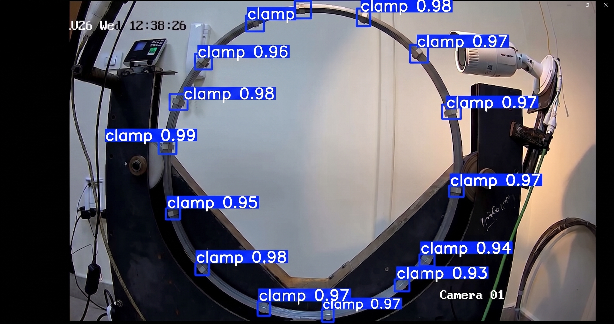

# Clamp Detection (YOLOv11)

Detecting clamps on an industrial test rig with YOLOv11. The model
(`best.pt`) was trained on Google Colab on frames extracted from rig CCTV
footage; this repo holds the data pipeline, the annotated dataset, the
trained weights, and a sample detection result.



## Pipeline

1. **Frame extraction** — `opencvcode.py` samples 30 evenly spaced frames
   from the source video into `clamp_frames/` (needs `Task.mp4` on disk —
   see note on source footage below).
2. **Annotation** — frames were labelled on Roboflow
   (`Clamp annotation.v1i.yolov11.zip` is the dataset export, YOLOv11 format).
3. **Training** — YOLOv11 training ran on Google Colab (GPU).
4. **Result** — `best.pt` is the trained weights; `detection-sample.jpg`
   shows it firing at 0.93–0.99 confidence on rig footage.

## Reproduce

```bash
pip install -r requirements.txt
python opencvcode.py          # needs Task.mp4 in this folder
```

Inference with the trained weights:

```python
from ultralytics import YOLO
model = YOLO("best.pt")
model.predict("clamp_frames/frame_00.jpg", show=True)
```

## Notes & known gaps

- **Source footage not versioned.** `Task.mp4` (74MB) and the two `.avi`
  captures (300MB+) exceed sane Git limits and are gitignored. Keep them
  locally; `clamp_frames/` reproduces from `Task.mp4` via `opencvcode.py`.
- **Training notebook missing.** Only its output (`best.pt`) survives here —
  the Colab notebook itself was never saved into this folder. If you still
  have the Colab link, export it and drop the `.ipynb` in here.
- **Case-sensitivity bug (not fixed, documenting):** `opencvcode.py` opens
  `"task.mp4"` but the file on disk is `Task.mp4`. Works on Windows,
  fails on Linux. Rename the file or the string before running cross-platform.
- `task-brief.docx` is the original task description.

## Contents

| File | Description |
|---|---|
| `opencvcode.py` | Frame extractor (video → 30 jpgs) |
| `best.pt` | Trained YOLOv11 weights (39MB) |
| `Clamp annotation.v1i.yolov11.zip` | Roboflow dataset export |
| `clamp_frames/` | 30 extracted frames |
| `detection-sample.jpg` | Sample detection output |
| `task-brief.docx` | Original task brief |

## License

MIT — see [LICENSE](LICENSE).
